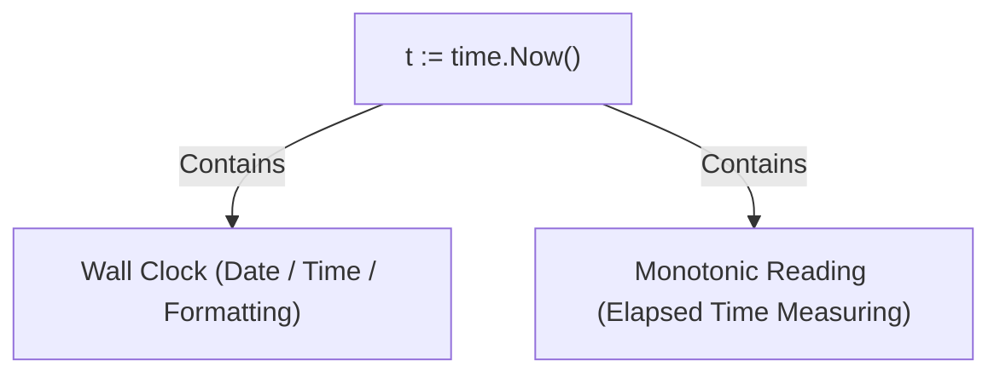

# Go Cheat Sheet & Mental Model (TypeScript/Node to Go)

This cheat sheet maps concepts from TypeScript/Jest (like `__repoSharedTests__/shopifyAccountRepoSharedTests.ts`) to idiomatic Go.

---

## 1. Test Discovery & File Naming Rules

In Jest/TypeScript, test runners match glob patterns like `**/*.test.ts`, `**/*.spec.ts`, or anything inside `__tests__/` or `__repoSharedTests__/`. In Go, the compiler enforces strict rules:

| Concept | TypeScript / Jest | Go |
| :--- | :--- | :--- |
| **Test file suffix** | `.test.ts` or `.spec.ts` | **Must be `_test.go` (singular)** (e.g. `storage_test.go`) |
| **Plural `_tests.go`** | Treated as test file if matching glob | ❌ **Treated as production code!** (Breaks build if package names mismatch) |
| **Test function signature** | `it("does something", () => {})` | `func TestXxx(t *testing.T)` (Starts with `Test` + Capital letter) |
| **Shared / Helper functions** | `describeSharedTests(...)` | `func RunSharedContractTests(t *testing.T, ...)` (Does not start with `Test` so `go test` won't run it directly) |

---

## 2. Package Organization & Directory Rules

In TypeScript, multiple files in the same folder can export anything independently. In Go:

1. **One package per folder:** Every non-test file in a directory **must** declare the same package name (e.g., `package object`).
2. **Never name a file `_tests.go`:** If you put `package object_test` in a file named `storage_contract_tests.go`, Go treats it as production code and complains:
   ```text
   found packages object (storage.go) and object_test (storage_contract_tests.go) in ...
   ```
3. **The `_test` package exception (Black-Box vs White-Box Testing):**
   Within any test file (`*_test.go`), Go allows **only two choices** for the package name:

| Testing Style | Package Declaration | What it can access | When to use |
| :--- | :--- | :--- | :--- |
| **White-Box** (Internal) | `package auth` (same as directory) | **Everything:** both exported (`Public`) and unexported (`private`) structs, fields, functions | Testing complex unexported logic, mocking internal state, testing private helpers |
| **Black-Box** (External) | `package auth_test` (`<pkg>_test`) | **Public API only:** must import the package (`import ".../internal/auth"`), can only see exported symbols | Testing the package from a real consumer's viewpoint; **prevents circular dependencies** |

---

## 3. Visibility & Type Syntax (Public vs Private)

In Go, there are no `public` or `private` keywords. Visibility is strictly controlled by **capitalization**:

| Concept | Unexported (Private) | Exported (Public) |
| :--- | :--- | :--- |
| **Identifiers** | Lowercase first letter: `uploadPolicy`, `key` | Uppercase first letter: `UploadPolicy`, `Key` |
| **Scope** | Visible only inside the same package | Accessible to any importing package |
| **JSON Serialization** | `json.Marshal` ignores lowercase fields! | Must be uppercase to be serialized to JSON |

### Struct Declaration & Instantiation Syntax:
* **Declare a struct:** use `type Name struct`, **never** `struct Name` (which is a syntax error).
* **Return pointer:** Instantiate and return address directly without temporary variables:

```go
// 1. Declaration
type UploadPolicy struct {
    Key string `json:"key"`
}

// 2. Constructor returning pointer
func NewUploadPolicy(key string) *UploadPolicy {
    return &UploadPolicy{
        Key: key,
    }
}
```

### Struct Tags (Go's Metadata Annotations):
Struct tags are compile-time string metadata in backticks (`` `key:"value"` ``) attached to struct fields.

* **History & Philosophy:** Present since Go's 2009 release (and Go 1.0). The creators (Rob Pike, Ken Thompson) deliberately avoided heavy annotation/macro frameworks (like in Java/Spring). They chose the simplest possible compromise: raw string metadata attached to fields, inspected at runtime via reflection (`reflect.StructTag`).
* **Not Just for JSON:** It is a general-purpose language feature:
  * `json:"key"` &rarr; `encoding/json`
  * `db:"col_name"` / `gorm:"primaryKey"` &rarr; Database ORMs
  * `validate:"required,email"` &rarr; Struct validation libraries
  * `env:"PORT"` &rarr; Environment variable loaders
* **Combining tags:** Multiple packages can read the same field:
  ```go
  type UploadPolicy struct {
      Key       string `json:"key" db:"object_key" validate:"required"`
      ExpiresAt int64  `json:"expires_at,omitempty"`
      Secret    string `json:"-"` // "-" means completely ignore / hide from JSON
  }
  ```
* **Golden Rule for JSON:** The field **must start with a Capital letter (exported)**, or `json.Marshal` will silently ignore it regardless of any tags!

### Functional Options Pattern (The Go Alternative to OOP Builders):
Instead of Java-style fluent builders (`new Builder().WithX().Build()`), Go uses variadic closures (`opts ...Option`) for constructors with optional configuration:

```go
type UploadOption func(*UploadPolicy)

func WithMaxContentLength(bytes int64) UploadOption {
    return func(p *UploadPolicy) {
        p.MaxContentLength = bytes
    }
}

// Usage: NewUploadPolicy("avatar.png", WithMaxContentLength(5*1024*1024))
func NewUploadPolicy(key string, opts ...UploadOption) *UploadPolicy {
    p := &UploadPolicy{Key: key}
    for _, opt := range opts {
        opt(p)
    }
    return p
}
```

---

## 4. Reusable Contract / Compliance Tests Pattern

### TypeScript / Jest Pattern:
```typescript
// __repoSharedTests__/shopifyAccountRepoSharedTests.ts
export function describeShopifyAccountRepoContract(createRepo: () => ShopifyAccountRepo) {
  describe("ShopifyAccountRepo Contract", () => {
    it("saves and finds account", async () => {
      const repo = createRepo();
      // assertions...
    });
  });
}
```

### Equivalent Idiomatic Go Pattern:
```go
// internal/object/storage_contract_test.go  (Notice: _test.go singular)
package object_test

import (
	"testing"
	"github.com/kzielonka/object-cloud/internal/object"
)

type FileSystemFactory func(t *testing.T) object.FileSystem

// RunFileSystemContract is a helper (does NOT start with Test), so it only runs when invoked
func RunFileSystemContract(t *testing.T, newFS FileSystemFactory) {
	t.Run("saves and reads back file content", func(t *testing.T) {
		fs := newFS(t)
		// test logic...
	})

	t.Run("returns ErrNotFound when file does not exist", func(t *testing.T) {
		fs := newFS(t)
		// test logic...
	})
}
```

### Running the Contract in Adapter Test Files:
```go
// internal/object/in_memory_storage_test.go
func TestInMemoryFileSystem_Contract(t *testing.T) {
	RunFileSystemContract(t, func(t *testing.T) object.FileSystem {
		return object.NewInMemoryFileSystem()
	})
}
```

---

## 5. Errors & Comparisons

| Action | TypeScript | Go |
| :--- | :--- | :--- |
| **Throwing error** | `throw new Error("msg")` | `return nil, errors.New("msg")` |
| **Wrapping error** | `new Error("msg", { cause: err })` | `fmt.Errorf("msg: %w", err)` |
| **Catching / Checking** | `if (err instanceof NotFoundError)` | `if errors.Is(err, object.ErrNotFound)` |
| **Extracting error struct** | `const e = err as CustomError` | `var e *CustomError; if errors.As(err, &e) { ... }` |

---

## 6. Quick Syntax Differences

* **No semicolons:** Do not put `;` at the end of lines.
* **No colons in parameter lists:** `func(path string)` (NOT `path: string`).
* **Struct initialization:** `&MyStruct{Field: val}` with curly braces `{}` (NOT `new MyStruct()` or `MyStruct()`).
* **Byte comparison:** `bytes.Equal(a, b)` instead of converting `string(a) == string(b)`.

---

## 7. Advanced Go Patterns & Security Best Practices

### 1. Constant-Time Comparisons for Crypto (Timing Attacks):
Standard comparisons (`bytes.Equal(a, b)` or `str1 == str2`) **early-exit** on the very first mismatched byte. An attacker can measure request latency down to nanoseconds to guess signatures or tokens byte-by-byte (a **timing attack**).

* **The Rule:** Always use **`crypto/hmac.Equal(mac1, mac2)`** or **`crypto/subtle.ConstantTimeCompare(x, y)`**.
* **How it works:** It always compares every single byte in the buffer, executing in constant time regardless of where the mismatch occurs.

### 2. Cryptographic Signatures: The "Sign Raw Bytes" Rule
* **The Vulnerability (JSON Malleability):** Two different JSON strings can decode to the exact same Go struct (due to key ordering, whitespace, or number formats). If you re-marshal JSON before verification, subtle canonicalization differences can break signatures or expose parser differentials.
* **The Best Practice:** Always sign the **exact raw incoming bytes**:
  $$\text{Token} = \text{Base64URL}(\text{rawPayloadBytes}) \ . \ \text{Base64URL}(\text{HMAC}(\text{secret}, \text{rawPayloadBytes}))$$
  1. Split on `.`.
  2. Verify HMAC directly against `rawPayloadBytes` using `hmac.Equal`.
  3. Only unmarshal into a Go struct **after** cryptographic verification succeeds.

### 3. Interface Design: "Accept Interfaces, Return Concrete Structs"
* **Return concrete types:** Constructors (`New...`) should return concrete structs (`*Store`, `*UploadPolicy`), giving callers the full API without premature abstraction.
* **Define interfaces at the consumer:** Instead of creating large producer interfaces (`IStore`), consumers define small (1–2 method) interfaces locally where needed:
  ```go
  // In internal/server/server.go
  type Downloader interface {
      Download(key string) (io.ReadCloser, error)
  }
  ```
  Because Go uses implicit/structural typing, any struct with matching methods automatically satisfies `Downloader`.

### 4. Method Receivers: Value `(t Type)` vs Pointer `(t *Type)`:

| Consideration | Pointer Receiver `(t *Type)` | Value Receiver `(t Type)` |
| :--- | :--- | :--- |
| **Mutation** | Modifies struct fields | Read-only copy |
| **Concurrency** | Struct contains `sync.Mutex` (**never copy a mutex!**) | No synchronization primitives inside |
| **Performance / GC** | Large structs (avoids copying bytes) | Small data structs (stays on CPU stack, avoids heap allocation) |
| **Consistency** | If *any* method needs a pointer receiver, use pointer receivers for **all** methods on that type. | |

### 5. Advanced Error Architecture: Sentinel Errors vs Custom Error Types:
* **Sentinel Errors (`errors.Is`):** For simple status/branching decisions without metadata:
  ```go
  var ErrInvalidSignature = errors.New("invalid signature")
  if errors.Is(err, auth.ErrInvalidSignature) { ... }
  ```
* **Custom Error Types (`errors.As`):** When the caller needs programmatic access to error metadata:
  ```go
  type ExpiredError struct {
      ExpiredAt time.Time
  }
  func (e *ExpiredError) Error() string {
      return fmt.Sprintf("token expired at %s", e.ExpiredAt)
  }

  // Caller extraction:
  var expErr *auth.ExpiredError
  if errors.As(err, &expErr) {
      fmt.Println("Expired at:", expErr.ExpiredAt)
  }
  ```

### 6. The `defer` Trap in Loops:
`defer` executes when the **enclosing function returns**, **not** when a loop iteration finishes. Running `defer file.Close()` inside a loop of 10,000 files will leak open file descriptors until the entire function exits.

* **The Fix:** Wrap the loop body in an anonymous closure so `defer` fires on each iteration:
  ```go
  for _, path := range files {
      func() {
          f, _ := os.Open(path)
          defer f.Close() // runs at the end of each iteration!
          // process...
      }()
  }
  ```

### 7. `time.Time`: Wall Clock vs. Monotonic Clock (The `t1 == t2` Trap):
Introduced in Go 1.9 (after Cloudflare's 2016 leap-second DNS outage), every `time.Time` struct can hold **two distinct clocks** at once:

1. **Wall Clock (for *telling* time):** Represents calendar date and time-of-day. Used when printing, formatting (`t.Format`), or serializing to JSON/databases. **Susceptible to NTP clock jumps, daylight savings, and leap seconds.**
2. **Monotonic Clock (for *measuring* time):** A CPU counter that strictly ticks forward and **never moves backwards**, immune to NTP adjustments and leap seconds. Used automatically by `t2.Sub(t1)`, `time.Since(t1)`, and `t1.Before(t2)`.



#### The Critical Bug: NEVER use `t1 == t2`!
Go's `==` operator compares struct fields bit-by-bit, including the internal monotonic reading and timezone pointers:
```go
t1 := time.Now()
t2 := t1.Round(0) // Strips the monotonic clock reading

// Even though both represent the EXACT same instant:
fmt.Println(t1 == t2)      // ❌ FALSE! (t1 has monotonic reading, t2 does not)
fmt.Println(t1.Equal(t2)) // ✅ TRUE! Always use .Equal()
```
* **Rule:** If `t1` came from `time.Now()` and `t2` came from JSON/DB/parsing, `t1 == t2` will **almost always return `false`**.
* **Fix:** **Always use `t1.Equal(t2)`** to compare points in time.
* **Stripping monotonic reading:** Call `t.Round(0)` or `t.Truncate(0)` if you explicitly want to strip the monotonic clock (e.g. before asserting in certain test matchers).

